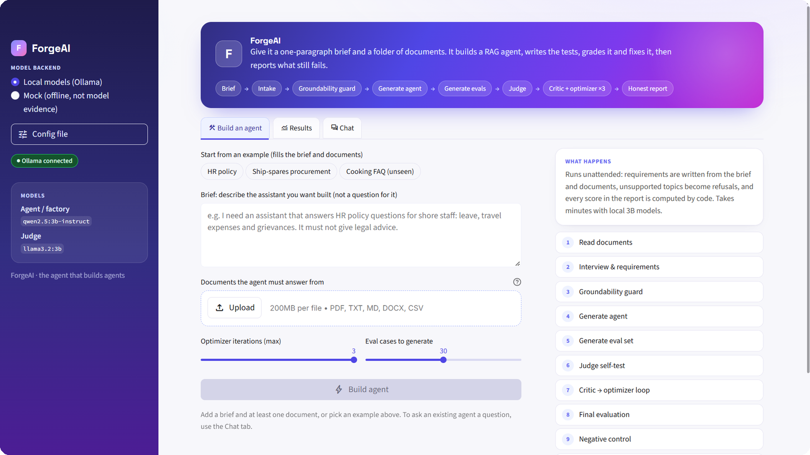
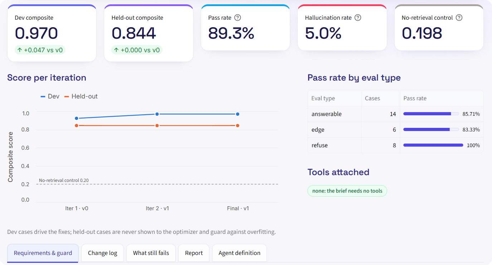
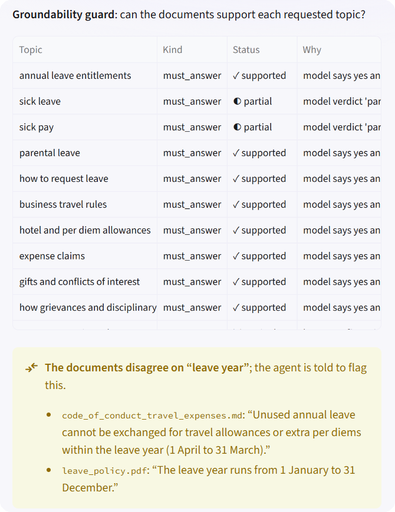
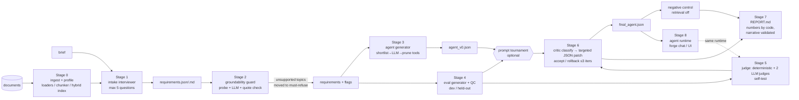

# ForgeAI — the agent that builds agents

**Input:** a one-paragraph brief and a folder of documents (PDF, TXT, MD, DOCX, CSV).
**Output, produced unattended:**
- a working, tested document-grounded agent (system prompt, retrieval config, justified tool selection, output contract),
- an auto-generated and quality-controlled eval set,
- a critic-optimizer loop (max 3 iterations) with a per-iteration scorecard,
- an honest `REPORT.md` whose numbers are computed from logs by code,
- a generic runtime / chat CLI that loads any produced agent.

Every stage runs on a small, imperfect open model (Ollama by default). The pipeline treats every model output as
untrusted: schema validation, JSON repair, retries with error feedback, and deterministic cross-checks that can
override the model. It also distrusts itself: eval QC, a judge self-test, a negative-control baseline, a number
validator on the report, and warnings when scores look too good.

> **What was produced with which backend.** Both committed demos (`demos/run_hr`, `demos/run_procurement`) were
> produced end to end by **real local models via Ollama**: `qwen2.5:3b-instruct` (agent + factory) and `llama3.2:3b`
> (judge), on a 4 GB GTX 1650 (see [`configs/ollama_small.toml`](configs/ollama_small.toml)). The test suite and
> `make mock-demo` use the deterministic **mock** backend; every mock report carries a banner saying it is not model
> evidence. The default [`forge.toml`](forge.toml) names `qwen2.5:7b-instruct` / `llama3.1:8b` for machines that fit them.

## See it working

Screenshots of the web UI (`python -m forge ui`) running on the local real models (`qwen2.5:3b-instruct` agent, `llama3.2:3b` judge).

### 1. Describe the agent you want: a brief plus documents



You write one paragraph saying what the assistant should do and upload the documents it must answer from (or pick a built-in example). ForgeAI then runs ten stages unattended, shown on the right: it reads the documents, writes requirements, checks that the documents can support each topic, generates the agent, generates its tests, checks its own judge, then runs up to three critic-optimizer iterations, a final evaluation, a no-retrieval control and an honest report.

### 2. Every run ships with evidence, not just an agent


The HR demo: the original brief, then the headline numbers computed by code from the eval logs. The **no-retrieval control** (0.198) is the same agent with its documents switched off. The large gap to the real score shows the tests actually depend on the documents. The "replayed from cache" tag is shown because this committed run reused recorded real-model outputs (see [Demo results](#demo-results-filled-from-the-committed-artifacts)).

### 3. The critic-optimizer loop, measured on dev and held-out cases



Iteration 1 tests the first agent (v0). The critic classifies each failure (retrieval miss, prompt defect, hallucination, wrong refusal), and the optimizer applies one targeted patch. Here a wrong refusal was fixed by relaxing the refusal rule. A patch is kept only if dev improves and held-out (never shown to the optimizer) does not drop; otherwise it is rolled back. The score is not 100%: the remaining failures are listed under *What still fails*.

### 4. The groundability guard refuses to invent what the documents don't say



Before building anything, every requested topic is checked against the documents with verified quotes. The HR brief asked for the *company pension scheme*, which no document covers, so it became a must-refuse topic instead of something the agent would make up. The guard also found that two documents give **different leave years** (1 Apr–31 Mar vs 1 Jan–31 Dec) and tells the agent to flag this.

### 5. The produced agent answers with citations


A live answer from the generated HR agent: the answer, the exact quote, the document and section it came from, and a confidence score. The agent card lists the agent's tools (none, because the brief needs none) and the topics it refuses. The suggested questions are taken from the agent's own generated test set.

## Architecture



All stages share one LLM client ([`forge/llm.py`](forge/llm.py)) and one runtime ([`forge/runner/agent_runtime.py`](forge/runner/agent_runtime.py)).
Evals execute the shipped runtime, so scores describe the product. Every stage writes its artifact before the next
starts, and completed stages are recorded in `run_meta.json`, so `forge run --resume <run_id>` continues after a crash.

## Quickstart

```bash
# 1. install (Python 3.11+)
pip install -e ".[dev,synth]"            # add ".[ui]" for the Streamlit app, ".[dense]" for local embeddings

# 2. offline, no model needed (deterministic mock backend)
make test                                # or: python -m pytest tests -q
make mock-demo                           # full pipeline on the unseen cooking-FAQ fixture in a few seconds

# 3. real local models
#    install Ollama (https://ollama.com), then:
ollama pull qwen2.5:3b-instruct && ollama pull llama3.2:3b      # 4 GB GPU profile used for the demos
#    (or for bigger GPUs: ollama pull qwen2.5:7b-instruct && ollama pull llama3.1:8b, and use forge.toml)
make synth                               # (re)render the demo documents
make demo-hr                             # ~1.5-2 h on a GTX 1650
make demo-procurement

# 4. chat with any produced agent
python -m forge chat --agent demos/run_hr/final_agent.json --config configs/ollama_small.toml --debug

# 5. UI (factory + chat)
python -m forge ui
```

Without `make` (Windows), run the commands in the [`Makefile`](Makefile) directly.

## Running on an unseen brief

```bash
python -m forge run --brief-file my_brief.txt --docs ./my_folder --non-interactive \
    [--answers answers.json] [--max-iters 3] [--budget-tokens 400000] [--approve-requirements] [--tournament 2]
```

- `--non-interactive`: intake answers come from `--answers` (keys = question id or field), otherwise from a
  *simulated requester* prompt that may only use the brief and documents and says "no preference" otherwise.
  Defaults are then recorded as **assumptions**.
- No domain knowledge lives in `forge/`; a test greps for demo-domain terms. The integration test runs the whole
  pipeline on a third, unseen domain (a cooking FAQ) and checks that the brief's undeliverable request (wine pairings)
  is caught by the groundability guard.
- Messy inputs are handled explicitly:
  - empty folder → clear error, exit code 1;
  - scanned / image-only PDFs → warning, file skipped;
  - huge files → truncated with a warning;
  - mixed types → supported;
  - non-English documents → language detected, agent told to answer in it;
  - contradictory documents → flagged in the groundability report, and the agent is told to cite both sides.
- LLM server down → `forge run` exits with code 2 and a clear message. Partial artifacts stay in `runs/<id>/`; continue with `--resume`.
- Every LLM call has a timeout, network retries with backoff, JSON repair, validation retries with error feedback,
  a deterministic fallback, a prompt-size cap and token/latency accounting. `--budget-tokens` / `--budget-seconds`
  set hard caps; when one is hit the optimizer stops early and the report says so.

## CLI

| command | purpose |
|---|---|
| `forge run …` | full factory (above); `--resume <run_id>`; `--copy-to demos/x` |
| `forge intake / groundability / generate / evalgen / judge / optimize / report --run-id X` | each stage alone, from that run's artifacts |
| `forge chat --agent path.json [--debug] [-q "question"]` | chat runner for any AgentDefinition |
| `forge regress --agent-run runs/<id> --new-docs ./folder2` | regression mode: rebuild index, regenerate agent, re-run the OLD eval set, report broken / fixed / **stale** cases |
| `forge baseline --run-id X --agent hand.json` | factory agent vs hand-written agent on the same evals, with a table of where each wins |
| `forge ui` | Streamlit factory + chat UI ([deployment guide](docs/DEPLOYMENT.md)) |
| `python scripts/acceptance_check.py` | runs the acceptance checklist and prints a pass/fail table |

## Requirements traceability

| # | core requirement | code | artifacts (per run, e.g. `demos/run_hr/`) | tests |
|---|---|---|---|---|
| 0 | ingestion + profiling with provenance | [`forge/ingest/`](forge/ingest) (`loaders`, `chunker`, `index`, `profile`, `embeddings`) | `doc_profile.json` | `test_runtime_ingest.py` |
| 1 | intake interviewer, ≤5 questions **enforced in code**, interactive / answers file / simulated requester, approval checkpoint | [`stages/intake.py`](forge/stages/intake.py) | `intake_qa.json`, `requirements.json`, `requirements.md` | `test_intake_groundability.py` |
| 2 | groundability guard: probe + LLM + verbatim-quote check, SUPPORTED/PARTIAL/UNSUPPORTED, gaps moved to must-refuse, contradictions | [`stages/groundability.py`](forge/stages/groundability.py) | `groundability_report.json`, flags in `requirements.md`, REPORT §3 | `test_groundability_*`, `test_contradiction_detection` |
| 3 | declarative AgentDefinition; tool selection shortlist → LLM → deterministic prune; retrieval heuristics | [`stages/generator.py`](forge/stages/generator.py), [`tools/registry.py`](forge/tools/registry.py), [`schemas.py`](forge/schemas.py) | `agent_v0.json`, `tool_selection.json`, `final_agent.json` | `test_tools.py` (no weather tool for HR, 320 dummy tools) |
| 4 | eval generator from documents + QC (verbatim quotes, retrievability, absence check, dedup, balance, seeded split) | [`stages/evalgen.py`](forge/stages/evalgen.py), `prompts/evalgen_*.md` | `eval_set.json`, `eval_generation_log.json` | `test_evalgen_judge.py` |
| 5 | hybrid judge + bias defenses + self-test | [`stages/judge.py`](forge/stages/judge.py), `prompts/judge_v1.md`, `judge_v2.md` | `iter_*/judgments.jsonl`, `judge_selftest.json` | `test_evalgen_judge.py` |
| 6 | critic (deterministic rules first) + optimizer (JSON patches, dev/held-out, rollback, ≤3 iters, early stop, budget) | [`stages/critic.py`](forge/stages/critic.py), [`stages/optimizer.py`](forge/stages/optimizer.py), [`budget.py`](forge/budget.py) | `iter_{1,2,3}/…`, `change_log.json`, `optimizer_summary.json` | `test_critic_optimizer_report.py` |
| 7 | honest report, numbers by code, narrative validator, negative control, suspicious-score warnings | [`stages/reporter.py`](forge/stages/reporter.py) | `REPORT.md`, `scorecard_summary.{json,md}`, `negative_control.json`, `report_validation.json`, `run_metrics.json` | `test_report_number_validator` |
| 8 | runtime + chat for any definition, tools via JSON protocol, contract enforcement | [`runner/agent_runtime.py`](forge/runner/agent_runtime.py), [`runner/chat_cli.py`](forge/runner/chat_cli.py), [`runner/app_ui.py`](forge/runner/app_ui.py) | — | `test_runtime_*`, `test_chat_cli_loads_any_definition` |
| 9 | two demos in different domains | [`scripts/synthesize_docs.py`](scripts/synthesize_docs.py), [`demos/synthesis_prompts/`](demos/synthesis_prompts) | [`demos/run_hr/`](demos/run_hr), [`demos/run_procurement/`](demos/run_procurement) | `scripts/acceptance_check.py` |

## How each stage works (short)

- **Stage 0, ingest.**
  - PDF pages, markdown/DOCX headings and CSV rows become sections with provenance (`page`, `section '…'`, `row N`).
  - Chunking strategies: `fixed` / `sentence` / `heading` / `row` (CSV is always row-wise).
  - Hybrid index: BM25 + dense embeddings, fused by weighted reciprocal rank fusion (`hybrid_alpha`), an absolute relevance score for `min_score`, and an optional overlap rerank. It persists under `.forge_index/`.
  - The profile is bounded in size: hierarchical map-reduce summaries, headings, TF-IDF key terms, CSV schema and samples.
- **Stage 1, intake.**
  - The model proposes questions; code dedups them, keeps one per field, and caps them at 5.
  - Answers come from the user, an answers file, or the simulated requester.
  - Requirements are drafted by the LLM and then merged by code: language from the documents, deterministic must-refuse and escalation extraction, tool needs validated against the brief, implied needs (CSV → `tabular_lookup`; arithmetic cues → `arithmetic`), and explicit assumptions.
- **Stage 2, groundability guard** (see S3–S5 in [DECISIONS](docs/DECISIONS.md)).
  - Unsupported topics and capabilities are removed from must-answer and added to must-refuse, with a console warning, flags in `requirements.md`, and a report section.
  - The generated prompt tells the agent to say it lacks the information.
- **Stage 3, generator.**
  - Code writes the grounding, citation, refusal, insufficient-context, contradiction and tool rules. The LLM writes the role, scope, tone and escalation.
  - The output contract is `{answer, sources[{doc, locator, quote}], confidence, refused, refusal_reason}`. The runtime enforces four rules (sources required when answering; quotes must appear in the context; a refusal has an empty answer and no sources; a refusal reason is required).
- **Stage 4, evals.** Per-category committed prompts:
  - answerable (≥10);
  - refuse (≥5): adversarial / must-refuse / absent / out-of-domain;
  - edge (≥5): multi-doc with `requires_docs`, numeric, colloquial, false-premise, ambiguous.

  QC and the dev/held-out split are described in [DECISIONS S8](docs/DECISIONS.md).
- **Stage 5, judge.** Deterministic metrics, each reported separately:
  - refusal (flag + phrase classifier);
  - citation validity (in the retrieved context AND in the source doc);
  - key-fact coverage (number-strict + lexical + fuzzy + embedding fallback);
  - retrieval hit@k;
  - contract compliance;
  - numeric consistency.

  On top of these, two LLM judges (pointwise rubric, temperature 0) score groundedness, correctness and refusal appropriateness. The composite is a weighted sum defined in config.
- **Stage 6, critic and optimizer.**
  - Every failure is classified into exactly one of the assignment's four categories, `retrieval_miss / prompt_defect / hallucination / wrong_refusal`, by rules R1–R15. Finer rule labels (`contract_violation`, `eval_defect`, `judge_uncertain`) are kept as a `subcategory` and choose the fix menu; they are reported under `prompt_defect` (or, for a suspected eval defect, under the other rule candidate).
  - Targeted patches per category, for example:
    - `top_k`, query expansion, `hybrid_alpha`, chunking;
    - quote-before-answer and number rules;
    - refusal relax / sharpen and injection rules;
    - an LLM-written general rule;
    - a paraphrased few-shot from a passing dev case.
  - Everything is logged in `change_log.json` with before/after values and scores.
- **Stage 7, report.** Sections: brief, requirements and assumptions, groundability, agent summary and tool justification, eval QC, per-iteration scorecard (dev vs held-out, per category, per metric), change log, negative control, **WHAT STILL FAILS AND WHY** (grouped by failure category with hypotheses), judge reliability, limitations, cost/latency.

## Judge-bias defenses

| failure mode | defense (implemented) | where |
|---|---|---|
| **Position bias** | Only pointwise scoring in evals. The pairwise judge is used only by the prompt tournament, is run in **both orders**, counts only when both orders agree, and only breaks exact ties. | `judge.py`, `optimizer.py::run_tournament` |
| **Self-preference** | Judge model is a different family from the agent (Llama vs Qwen); optional second judge model (`judge_model_2`); **deterministic checks veto** any LLM pass. | `config`, `judge.py::judge_case` |
| **Verbosity bias** | Rubric says length is ignored; length-normalised coverage (`coverage_per_100_words`); a `verbosity_flag` when a long answer is rated correct by the LLM but has low fact coverage; the self-test includes a padded-answer perturbation. | `judge.py`, `prompts/judge_v*.md` |
| **Small-model judge unreliability** | Two independently worded judge prompts must agree, otherwise the case is `judge_uncertain` and the deterministic verdict stands. Agreement rate is reported. A **self-test** builds known-good / padded / false-number / unsupported-claim / wrongly-answered-refusal answers from dev cases and reports judge accuracy; below the threshold (0.7) the report warns loudly. | `judge.py::run_selftest` |
| **Our own pipeline lying** | Eval quote verification; retrievability and mislabel checks; negative control; "suspicious: verify eval difficulty" warning above 95 % pass; report number validator; mock-backend banner. | `evalgen.py`, `reporter.py` |

## Demo results (filled from the committed artifacts)

_Generated by `python scripts/demo_summary.py` from `demos/run_*/`. Real local models, see banner at the top._

### HR policy assistant — [`REPORT.md`](demos/run_hr/REPORT.md)

- removed by the groundability guard (now refused): ['company pension scheme']
- tools attached: none
- remaining failures by category: {'prompt_defect': 2, 'hallucination': 1}
- LLM calls 286, tokens 222113, wall time 13.94 s

### Ship-spares procurement assistant — [`REPORT.md`](demos/run_procurement/REPORT.md)

- removed by the groundability guard (now refused): ['internet_api']
- tools attached: ['csv_lookup', 'calculator']
- remaining failures by category: {'prompt_defect': 4, 'hallucination': 1, 'wrong_refusal': 2}
- LLM calls 726, tokens 839067, wall time 19.71 s

| demo | evals | v0 composite dev / held-out | final composite dev / held-out | negative control | final pass | halluc. | judge self-test | patches accepted / rolled back |
|---|---|---|---|---|---|---|---|---|
| HR policy assistant | 28 | 0.923 / 0.844 | 0.970 / 0.844 | 0.198 | 89.3% | 5.0% | 80.8% | 1 / 0 |
| Ship-spares procurement assistant | 30 | 0.740 / 0.651 | 0.883 / 0.799 | 0.186 | 76.7% | 4.2% | 80.8% | 2 / 4 |

**Reading these results honestly**
- Different domains surfaced different failure categories:
  - HR's patch fixed an **over-refusal** (`wrong_refusal`).
  - Procurement's accepted patches fixed **contract violations** (a format few-shot) and **missed refusals** (a manipulation-refusal rule).
- **Rollbacks are real.** In procurement, 4 of 6 patches were rolled back: twice because dev regressed, and twice because dev was flat while held-out dropped beyond tolerance (the overfitting guard working).
- **Traps caught:**
  - HR: the pension scheme is absent from the documents and was removed and refused; the planted leave-year contradiction (1 Jan vs 1 Apr) was flagged.
  - Procurement: "live stock-market prices / customs duty" has no tool or document behind it and is refused.
  - HR gets no tools; procurement gets exactly `csv_lookup` + `calculator`.
- **The judge is imperfect.** `llama3.2:3b` scored 80.8 % on the perturbation self-test and is weakest at spotting injected unsupported claims; see each report's judge-reliability section. Deterministic checks keep veto power.
- **Still failing:** see "WHAT STILL FAILS AND WHY" in each report.
- **Factory vs hand-written baseline** ([`demos/run_hr/BASELINE_COMPARISON.md`](demos/run_hr/BASELINE_COMPARISON.md), real models, same 28 evals):
  - composite 0.925 vs 0.791, pass 89.3 % vs 64.3 %;
  - the factory agent wins 7 cases, the hand-written agent wins 0, both fail 3;
  - the hand-written agent hallucinated less (0 % vs 5 %, a single case), so the factory's gain comes from fewer wrong refusals and better fact coverage, not from more grounding.
- **Timing and cache replay:** both committed demo runs were regenerated after the failure categories were aligned to the assignment's four (only labels changed; no prompt changed). Every LLM call (HR 286, procurement 726) was served from the disk cache of the earlier real-model runs, so `run_metrics.json` shows seconds of wall time and near-zero latencies. The outputs are real-model outputs for the exact same prompts. The original live procurement run took 2258.66 s for 726 calls (311 cached); see `run_metrics.json` in commit `acd3a41`. The HR baseline comparison files keep their original live latencies.

## Design decisions and limitations

See [`docs/DECISIONS.md`](docs/DECISIONS.md) for the full list and [`docs/PROMPTS.md`](docs/PROMPTS.md) for the prompt index.
The main limitations, which every `REPORT.md` repeats:
- 3B models: weak instruction following, many refusals or omissions; the deterministic checks compensate but cannot add knowledge.
- Synthetic evals are generated from the same documents (eval/doc coupling) and probe faithfulness, not real traffic.
- Factory and judge share blind spots.
- Lexical fact matching under-credits paraphrases.
- Held-out sets are small, so one case moves held-out scores by 5–10 points.
- English-centric stemming and refusal phrases.
- No OCR.
- Native function calling is not used (JSON tool protocol instead).

## Repo layout

```
forge/        llm.py config.py schemas.py budget.py logging_utils.py textutils.py context.py mock_backend.py pipeline.py cli.py
  ingest/     loaders.py chunker.py index.py embeddings.py profile.py
  tools/      registry.py csv_lookup.py calculator.py http_api.py current_date.py distractors.py (unit_converter + 3 stubs)
  stages/     intake.py groundability.py generator.py evalgen.py judge.py critic.py optimizer.py reporter.py regression.py baseline.py
  runner/     agent_runtime.py chat_cli.py app_ui.py
prompts/      22 versioned prompt templates (docs/PROMPTS.md)
demos/        brief_*.txt, sources/, synthesis_prompts/, hand_written/, run_hr/, run_procurement/
configs/      ollama_small.toml (4 GB GPU profile used for the demos)
scripts/      synthesize_docs.py, acceptance_check.py
tests/        pytest suite (mock backend, offline) + fixtures/cooking_faq (third, unseen domain)
docs/         DECISIONS.md PROMPTS.md DEPLOYMENT.md
```
