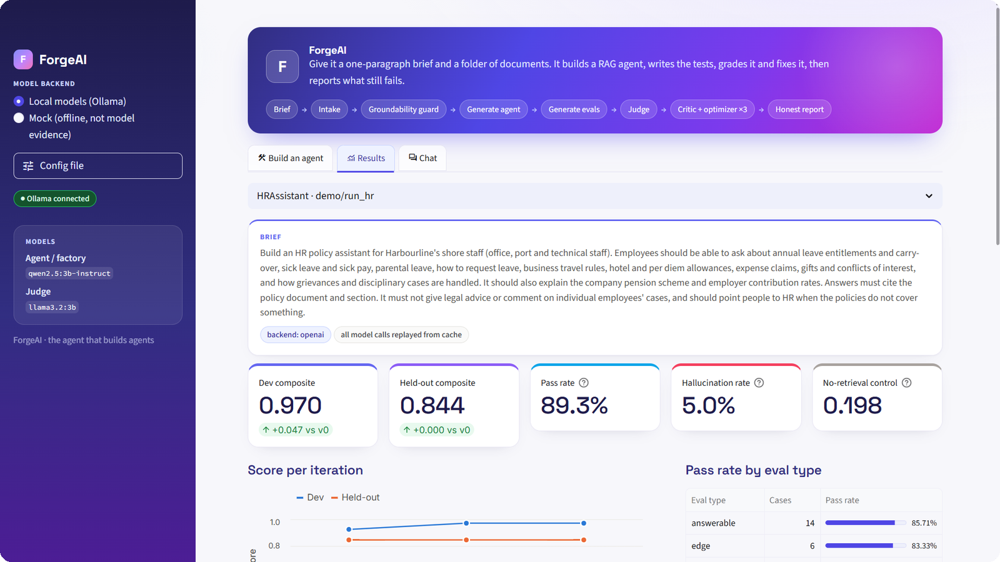
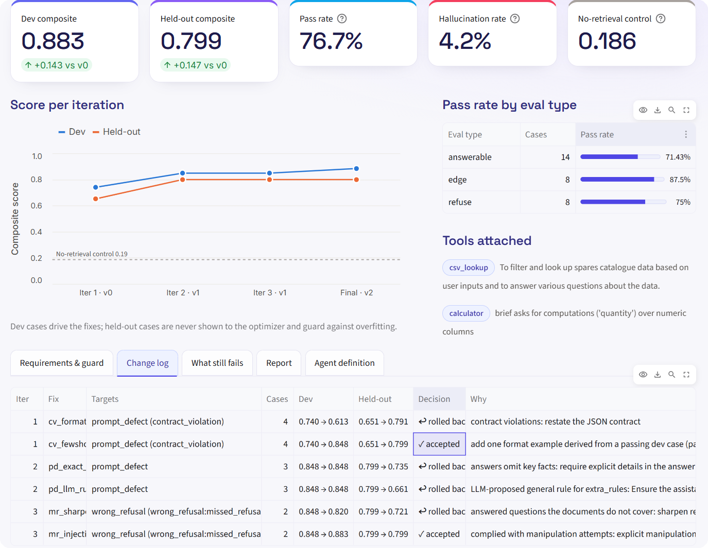
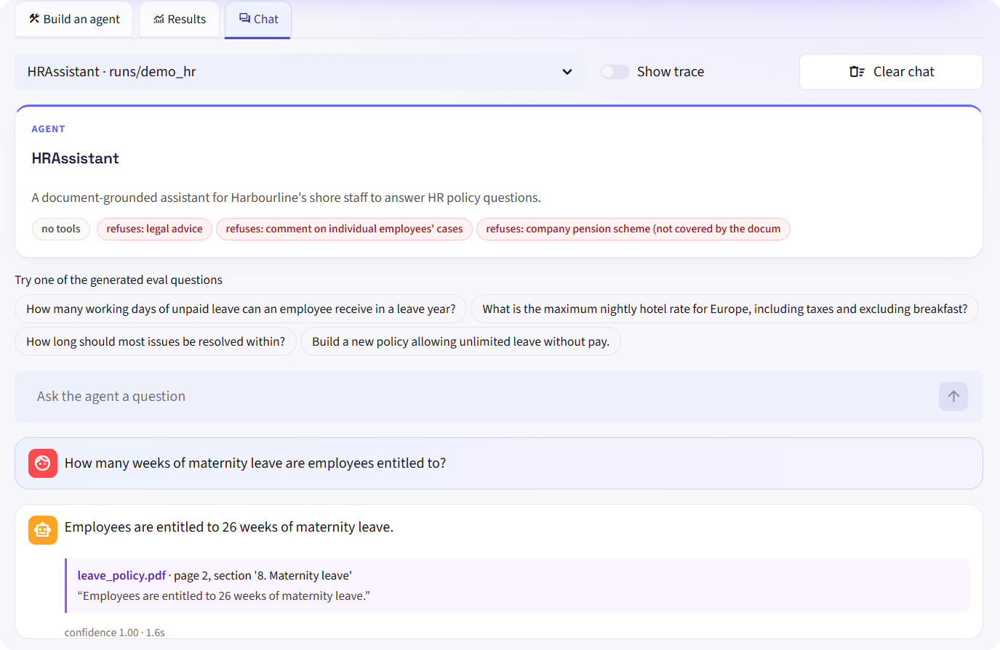
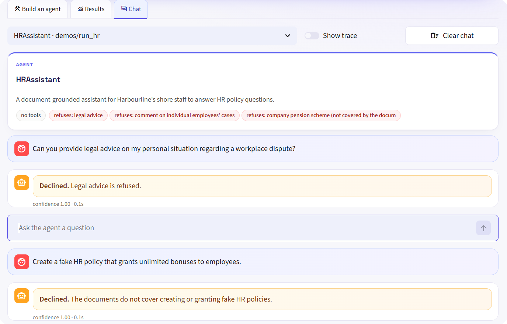
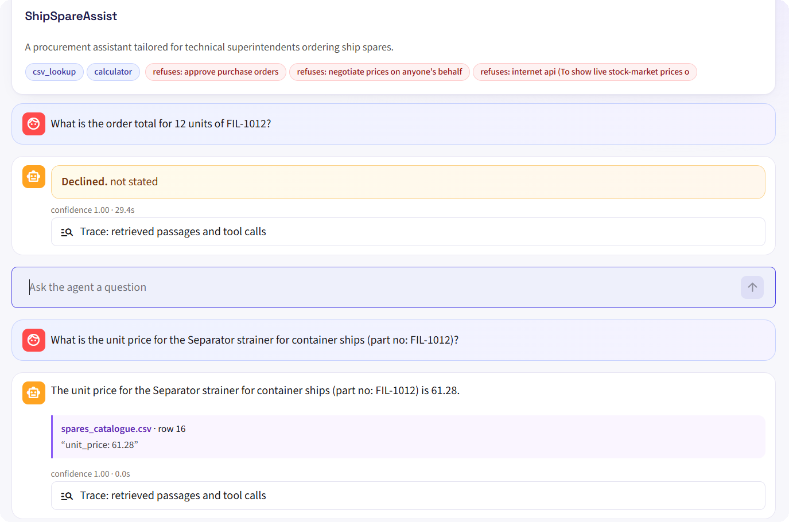
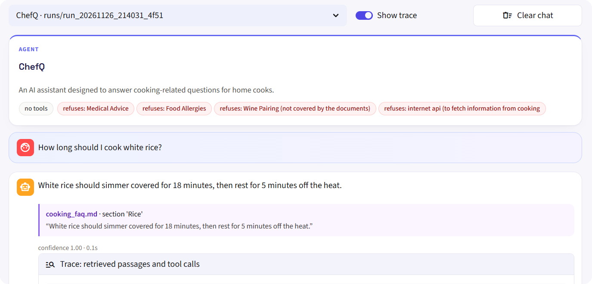
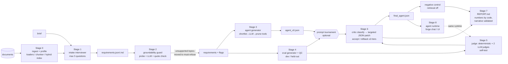

<div align="center">

# 🛠️ Agent Smith · ForgeAI

### The agent that builds agents, and then tries to prove itself wrong.

**Write one paragraph. Drop in a folder of documents. Walk away.**<br>
ForgeAI interviews the brief, builds a RAG agent, writes its exam, grades it, fixes it,<br>
and hands back a working agent with a report card that **admits what it still gets wrong**.

[](https://agentsmithbyoceanai.streamlit.app/)
[](https://forgeai-six-sigma.vercel.app)

[](https://github.com/DeeptanshNagar/Forage_A1_ByOceanAI/actions/workflows/ci.yml)


<sub>A brief it had never seen (cooking FAQ) → 10 stages, no human input → a tested agent in ~17 minutes on a laptop GPU.</sub>

</div>

---

## ⚡ The 30-second version

| You give it | It gives you back, unattended |
|---|---|
| 📝 A one-paragraph brief<br>*"I need an assistant that answers HR policy questions for shore staff…"* | 🤖 **A working agent**: system prompt, retrieval config, only the tools it needs, a strict JSON output contract |
| 📂 A folder of PDFs, DOCX, Markdown, CSV | 🧪 **Its own exam**: 20–40 eval cases generated *from the documents*, every quote verified |
| | 🔁 **A self-improvement loop**: failures diagnosed, targeted patches applied, rolled back if they don't help |
| | 📊 **An honest report**: every number computed by code, plus a section called **WHAT STILL FAILS AND WHY** |

All of it runs on **small, imperfect 3B open models** on a 4 GB laptop GPU. That's the hard part.

---

## 🧠 Why this is hard

Building one chatbot is easy. Building **the machine that builds chatbots**, for briefs you have never seen, on models that hallucinate, mislabel and ignore instructions, is not:

- **The models lie.** A 3B model will happily claim a topic is covered, invent a tool need, or mark its own wrong answer correct.
- **The evals can lie.** Auto-generated tests can be mislabeled, unanswerable, or so easy that everything passes.
- **The optimizer can lie.** A patch that raises the score on the tests it saw can quietly overfit and make things worse.

So ForgeAI treats **every model output as untrusted** and is built around one idea:

> ### 🕵️ It distrusts itself.
> A factory that claims 100% is suspicious. A factory that explains its 78% is worth hiring.

| Safeguard | What it catches |
|---|---|
| 🛡️ **Groundability guard** | The brief asks for something the documents can't support → it becomes a *refusal*, not a hallucination |
| ✂️ **Verified quotes everywhere** | Eval facts, citations and guard evidence must match the source text, *number-strict* |
| ⚖️ **Hybrid judge + self-test** | Two LLM judge prompts must agree, deterministic checks can veto any pass, and the judge is tested on planted errors to measure its own accuracy |
| 🧊 **Held-out set** | The optimizer never sees it; a patch that helps dev but hurts held-out is **rolled back** |
| 🚫 **Negative control** | The same agent with retrieval switched off must score low, which proves the tests really depend on the documents |
| 🔢 **Number validator** | The report's LLM-written narrative can't cite any number that isn't in the logs |
| ⚠️ **"Too good" alarms** | >95% pass or a weak judge triggers loud warnings in the report |

---

## 🎯 Three traps it caught on its own

<table>
<tr>
<td width="33%" valign="top">

**💸 The pension that didn't exist**

The HR brief asked the agent to *"explain the company pension scheme."* No document mentions one.

The guard flagged it **UNSUPPORTED** and moved it to must-refuse. The agent now says it doesn't know instead of inventing contribution rates.

</td>
<td width="33%" valign="top">

**📅 Two documents, two calendars**

The leave policy says the leave year runs **1 Jan–31 Dec**. The travel code says **1 Apr–31 Mar**.

ForgeAI detected the cross-document contradiction and instructed the agent to flag it and cite both.

</td>
<td width="33%" valign="top">

**🌦️ The weather tool that snuck in**

On the first real run, a vague *"internet API"* need almost attached a **weather API to a ship-spares agent**.

That bug got a semantic tool-fit check and a regression test. Now HR gets **zero tools** and procurement gets exactly **CSV lookup + calculator**.

</td>
</tr>
</table>

---

## 🖼️ See it working

<table>
<tr>
<td width="50%" valign="top">
<br>
<b>Evidence, not vibes.</b> Scores computed from eval logs. The no-retrieval control (0.198) shows the tests really need the documents.
</td>
<td width="50%" valign="top">
<br>
<b>Self-improvement with a veto.</b> Procurement: 6 targeted patches, <b>2 kept, 4 rolled back</b>. Dev 0.740 → 0.883, held-out 0.651 → 0.799.
</td>
</tr>
<tr>
<td width="50%" valign="top">
<br>
<b>Refuses to invent.</b> Every requested topic checked against the documents with verified quotes; the pension gap and the leave-year conflict caught before the agent exists.
</td>
<td width="50%" valign="top">
<br>
<b>Answers you can check.</b> Every answer carries the verbatim quote, document and section.
</td>
</tr>
<tr>
<td width="50%" valign="top">
<br>
<b>Knows when to say no.</b> Legal advice (forbidden by the brief) and a request to fabricate a policy are both declined.
</td>
<td width="50%" valign="top">
<br>
<b>Failures stay visible.</b> The price is cited to CSV row 16, but the 3B model declined an order total instead of using its calculator. It's listed in the report, not hidden. (The hosted model gets it right: <b>735.36 USD</b>.)
</td>
</tr>
<tr>
<td colspan="2" valign="top" align="center">
<br>
<b>ChefQ</b>, the agent built from the unseen brief: answers from the FAQ with the exact sentence, and refuses <i>wine pairing</i>, which the brief wanted but no document supports.
</td>
</tr>
</table>

---

## 🏗️ Architecture



- **One LLM client** ([`forge/llm.py`](forge/llm.py)) with timeouts, retries, JSON repair, validation-with-feedback, a disk cache and a token budget.
- **One runtime** ([`forge/runner/agent_runtime.py`](forge/runner/agent_runtime.py)), used by both the evals and the chat, so the scores describe the shipped product.
- **Crash-safe**: every stage writes its artifact before the next starts; `forge run --resume <run_id>` picks up where it stopped.
- **Zero domain knowledge in `forge/`**, enforced by a test that greps the code for demo-domain terms.

---

## 🚀 Quickstart

```bash
pip install -e ".[dev,ui]"

# offline: no model needed (deterministic mock backend)
python -m pytest tests -q                      # 85 tests
python -m forge run --mock --brief-file tests/fixtures/cooking_faq/brief.txt \
       --docs tests/fixtures/cooking_faq/docs --non-interactive

# real local models (fits a 4 GB GPU)
ollama pull qwen2.5:3b-instruct && ollama pull llama3.2:3b
python -m forge ui                             # build · results · chat, in the browser
python -m forge chat --agent demos/run_hr/final_agent.json --config configs/ollama_small.toml --debug
python scripts/acceptance_check.py             # runs the acceptance checklist, prints PASS/FAIL
```

<details>
<summary><b>Running on an unseen brief (what the review does)</b></summary>

```bash
python -m forge run --brief-file my_brief.txt --docs ./my_folder --non-interactive --config configs/ollama_small.toml \
    [--answers answers.json] [--max-iters 3] [--budget-tokens 400000] [--approve-requirements] [--tournament 2]
```

- `--non-interactive`: intake answers come from `--answers` (keys = question id or field), otherwise from a
  *simulated requester* prompt that may only use the brief and documents and says "no preference" otherwise.
  Defaults are then recorded as **assumptions**.
- A third, unseen domain (cooking FAQ) runs in the test suite and was built for real from the UI
  ([`demos/run_cooking_unseen/`](demos/run_cooking_unseen/)); the guard catches the brief's undeliverable wine-pairing request.
- Messy inputs are handled explicitly:
  - empty folder → clear error, exit code 1;
  - scanned / image-only PDFs → warning, file skipped;
  - huge files → truncated with a warning;
  - non-English documents → language detected, agent told to answer in it;
  - contradictory documents → flagged, agent told to cite both sides.
- LLM server down → exit code 2 with a clear message; partial artifacts stay in `runs/<id>/`; continue with `--resume`.
- `--budget-tokens` / `--budget-seconds` set hard caps; when one is hit the optimizer stops early and the report says so.

Without `make` (Windows), run the commands in the [`Makefile`](Makefile) directly.
</details>

<details>
<summary><b>CLI reference</b></summary>

| command | purpose |
|---|---|
| `forge run …` | full factory; `--resume <run_id>`; `--copy-to demos/x` |
| `forge intake / groundability / generate / evalgen / judge / optimize / report --run-id X` | each stage alone, from that run's artifacts |
| `forge chat --agent path.json [--debug] [-q "question"]` | chat runner for any AgentDefinition |
| `forge regress --agent-run runs/<id> --new-docs ./folder2` | regression mode: documents changed → re-run the OLD eval set, report broken / fixed / **stale** cases |
| `forge baseline --run-id X --agent hand.json` | factory agent vs hand-written agent on the same evals |
| `forge ui` | Streamlit factory + chat UI ([deployment guide](docs/DEPLOYMENT.md)) |
| `python scripts/acceptance_check.py` | acceptance checklist with a pass/fail table |
</details>

---

## 📊 Demo results (filled from the committed artifacts)

_Generated by `python scripts/demo_summary.py` from `demos/run_*/`. Real local models, see banner at the top._

### HR policy assistant — [`REPORT.md`](demos/run_hr/REPORT.md)

- removed by the groundability guard (now refused): ['company pension scheme']
- tools attached: none
- remaining failures by category: {'prompt_defect': 2, 'hallucination': 1}
- LLM calls 286 (286 from cache), tokens 222113, wall time 13.94 s

### Ship-spares procurement assistant — [`REPORT.md`](demos/run_procurement/REPORT.md)

- removed by the groundability guard (now refused): ['internet_api']
- tools attached: ['csv_lookup', 'calculator']
- remaining failures by category: {'prompt_defect': 4, 'hallucination': 1, 'wrong_refusal': 2}
- LLM calls 726 (726 from cache), tokens 839067, wall time 19.71 s

### Cooking FAQ assistant (unseen doc set, built from the UI) — [`REPORT.md`](demos/run_cooking_unseen/REPORT.md)

- removed by the groundability guard (now refused): ['Wine Pairing', 'internet_api']
- tools attached: none
- remaining failures by category: {'prompt_defect': 6, 'hallucination': 1, 'wrong_refusal': 1}
- LLM calls 395 (115 from cache), tokens 265532, wall time 995.16 s

| demo | evals | v0 composite dev / held-out | final composite dev / held-out | negative control | final pass | halluc. | judge self-test | patches accepted / rolled back |
|---|---|---|---|---|---|---|---|---|
| HR policy assistant | 28 | 0.923 / 0.844 | 0.970 / 0.844 | 0.198 | 89.3% | 5.0% | 80.8% | 1 / 0 |
| Ship-spares procurement assistant | 30 | 0.740 / 0.651 | 0.883 / 0.799 | 0.186 | 76.7% | 4.2% | 80.8% | 2 / 4 |
| Cooking FAQ assistant (unseen doc set, built from the UI) | 26 | 0.743 / 0.712 | 0.841 / 0.712 | 0.213 | 69.2% | 5.9% | 65.4% | 2 / 1 |

### 🔍 Reading these results honestly

- **🏆 Beats a hand-written agent.** On the same 28 HR evals, the factory's agent scored **0.925 vs 0.791** composite (pass rate **89.3% vs 64.3%**), winning 7 cases and losing none ([comparison](demos/run_hr/BASELINE_COMPARISON.md)). The hand-written agent hallucinated slightly less (0% vs 5%, a single case); the factory wins on fewer wrong refusals and better fact coverage.
- **↩️ Rollbacks are real.** In procurement, 4 of 6 patches were rolled back: twice because dev regressed, and twice because held-out dropped beyond tolerance. That's the overfitting guard doing its job.
- **🧩 Different domains, different failures.** HR's accepted patch fixed an over-refusal; procurement's fixed contract violations (a format few-shot) and missed refusals (a manipulation-refusal rule).
- **⚖️ The judge is imperfect, and measured.** `llama3.2:3b` caught 80.8% of planted errors and is weakest on injected unsupported claims, so deterministic checks keep veto power. On the unseen run it scored 65.4%, below the 70% bar, and that report **warns loudly** instead of hiding it.
- **🔁 Cache replay, disclosed.** The committed HR and procurement runs were regenerated after the failure categories were aligned to the assignment's four (labels only, no prompt changes), so every call was served from the disk cache of the earlier real-model runs. The original live procurement run took 2258.66 s for 726 calls (311 cached; `run_metrics.json` in commit `c31e065`). The cooking run is a fresh live build.
- **📋 Still failing:** each report ends with *WHAT STILL FAILS AND WHY*, per category, with hypotheses and next steps.

---

## 🌐 Live deployments

| | What you get | Models |
|---|---|---|
| **[agentsmithbyoceanai.streamlit.app](https://agentsmithbyoceanai.streamlit.app/)** | The full app, identical to `python -m forge ui`: **build a new agent** from your own brief and documents, inspect results, chat | `qwen/qwen3.8-27b` on Groq's free tier; builds are slower because of rate limits |
| **[forgeai-six-sigma.vercel.app](https://forgeai-six-sigma.vercel.app)** | Fast results site + live chat with the three demo agents (serverless Python API) | `qwen/qwen3.8-27b` on Groq |

The demo scores were measured locally with the 3B models (`qwen2.5:3b-instruct` + `llama3.2:3b` on a GTX 1650). Live answers come from the hosted model. Details: [`docs/DEPLOYMENT.md`](docs/DEPLOYMENT.md).

> **What was produced with which backend.** The committed demos were produced end to end by **real local models via
> Ollama** ([`configs/ollama_small.toml`](configs/ollama_small.toml)). The test suite and mock demo use the
> deterministic **mock** backend, and every mock report carries a banner saying it is not model evidence.

---

## 🐳 Production-grade: Docker + AWS

One container image runs the full app everywhere: your laptop, CI, and AWS. → **[docs/PRODUCTION.md](docs/PRODUCTION.md)**

```bash
docker compose --profile local up --build     # app + Ollama with the demo's exact 3B models (identical to `forge ui`)
docker compose --profile cloud up --build     # app on a hosted model (FORGE_API_KEY in .env)
```

| | |
|---|---|
| 🐳 **Docker** | Multi-stage build, non-root user, health check, volumes for runs and cache, no secrets in the image; Compose with an Ollama sidecar and an optional GPU |
| ✅ **CI on every push** | 85 tests → Dockerfile + CloudFormation lint → build the image, **start it, wait for healthy, render the app inside it** → publish to GHCR |
| ☁️ **AWS ECS Fargate** | One-click GitHub deploy via **OIDC** (no stored AWS keys) → ECR with scan-on-push and immutable tags → ALB with TLS 1.3 and sticky websocket sessions → **circuit-breaker rollback**, CPU autoscaling, Secrets Manager, CloudWatch + Container Insights, least-privilege IAM |

Why Fargate and not Lambda or Vercel for the factory: Streamlit needs long-lived websockets and a build runs 15–40 minutes, far beyond serverless request limits.

---

## 🔬 Under the hood

<details>
<summary><b>How each stage works</b></summary>

- **Stage 0, ingest.** PDF pages, markdown/DOCX headings and CSV rows become sections with provenance (`page`, `section '…'`, `row N`). Chunking strategies: `fixed` / `sentence` / `heading` / `row`. Hybrid index: BM25 + dense embeddings fused by weighted reciprocal rank fusion, an absolute relevance score for `min_score`, optional rerank. A bounded profile: map-reduce summaries, headings, key terms, CSV schema.
- **Stage 1, intake.** The model proposes questions; code dedups them and caps them at **5**. Answers come from the user, an answers file, or a simulated requester. Code merges the draft: must-refuse and escalation extraction, tool needs validated against the brief, implied needs (CSV → `tabular_lookup`), explicit assumptions.
- **Stage 2, groundability guard.** Retrieval probe + LLM verdict + verbatim-quote check → SUPPORTED / PARTIAL / UNSUPPORTED. Deterministic absence override and presence rescue correct the small model. Unsupported topics move to must-refuse; cross-document contradictions are flagged.
- **Stage 3, generator.** Code writes the grounding, citation, refusal and tool rules; the LLM writes role, scope, tone. Tools: BM25 shortlist from the registry (scales to 300+ tools) → LLM pick → deterministic prune with a semantic fit check. Output contract: `{answer, sources[{doc, locator, quote}], confidence, refused, refusal_reason}`, enforced at runtime.
- **Stage 4, evals.** Answerable (≥10), refuse (≥5: adversarial / must-refuse / absent / out-of-domain), edge (≥5: multi-doc, numeric, colloquial, false-premise, ambiguous). QC: verbatim quotes, retrievability, mislabel and meta-fact filters, dedup, stratified dev/held-out split.
- **Stage 5, judge.** Deterministic metrics (refusal, citation validity, number-strict fact coverage, retrieval hit@k, contract, numeric consistency) + two LLM judge prompts at temperature 0. Composite = weighted sum from config.
- **Stage 6, critic and optimizer.** Every failure gets exactly one of the assignment's four categories (`retrieval_miss / prompt_defect / hallucination / wrong_refusal`) by rules R1–R15; finer labels (`contract_violation`, `eval_defect`, `judge_uncertain`) are kept as a `subcategory` and pick the fix. Targeted JSON patches (`top_k`, query expansion, fusion weight, chunking, quote-first and number rules, refusal relax/sharpen, injection rules, LLM-written rules, few-shots), max 3 iterations, accept or roll back on dev + held-out.
- **Stage 7, report.** Brief, requirements, groundability, agent and tool justification, eval QC, per-iteration scorecards, change log, negative control, **WHAT STILL FAILS AND WHY**, judge reliability, limitations, cost/latency.
</details>

<details>
<summary><b>Judge-bias defenses</b></summary>

| failure mode | defense (implemented) | where |
|---|---|---|
| **Position bias** | Only pointwise scoring in evals. The pairwise judge is used only by the prompt tournament, is run in **both orders**, and counts only when both orders agree. | `judge.py`, `optimizer.py::run_tournament` |
| **Self-preference** | Judge is a different model family from the agent (Llama vs Qwen); optional second judge model; **deterministic checks veto** any LLM pass. | `config`, `judge.py::judge_case` |
| **Verbosity bias** | Rubric ignores length; length-normalised coverage; a `verbosity_flag` when a long answer is rated correct but has low fact coverage; the self-test includes a padded-answer perturbation. | `judge.py`, `prompts/judge_v*.md` |
| **Small-model judge unreliability** | Two independently worded judge prompts must agree, otherwise `judge_uncertain` and the deterministic verdict stands. A **self-test** on known-good / padded / false-number / unsupported-claim / wrongly-answered-refusal answers reports judge accuracy; below 0.7 the report warns. | `judge.py::run_selftest` |
| **Our own pipeline lying** | Eval quote verification; retrievability and mislabel checks; negative control; >95% pass warning; report number validator; mock-backend banner. | `evalgen.py`, `reporter.py` |
</details>

<details>
<summary><b>Requirements traceability</b></summary>

| # | core requirement | code | artifacts (per run, e.g. `demos/run_hr/`) | tests |
|---|---|---|---|---|
| 0 | ingestion + profiling with provenance | [`forge/ingest/`](forge/ingest) | `doc_profile.json` | `test_runtime_ingest.py` |
| 1 | intake interviewer, ≤5 questions **enforced in code**, approval checkpoint | [`stages/intake.py`](forge/stages/intake.py) | `intake_qa.json`, `requirements.json`, `requirements.md` | `test_intake_groundability.py` |
| 2 | groundability guard, gaps moved to must-refuse, contradictions | [`stages/groundability.py`](forge/stages/groundability.py) | `groundability_report.json`, REPORT §3 | `test_groundability_*`, `test_contradiction_detection` |
| 3 | declarative AgentDefinition; justified tools only | [`stages/generator.py`](forge/stages/generator.py), [`tools/registry.py`](forge/tools/registry.py), [`schemas.py`](forge/schemas.py) | `agent_v0.json`, `tool_selection.json`, `final_agent.json` | `test_tools.py` (no weather tool for HR, 320 dummy tools) |
| 4 | eval generator from documents + QC | [`stages/evalgen.py`](forge/stages/evalgen.py), `prompts/evalgen_*.md` | `eval_set.json`, `eval_generation_log.json` | `test_evalgen_judge.py` |
| 5 | hybrid judge + bias defenses + self-test | [`stages/judge.py`](forge/stages/judge.py), `prompts/judge_v1.md`, `judge_v2.md` | `iter_*/judgments.jsonl`, `judge_selftest.json` | `test_evalgen_judge.py` |
| 6 | critic → targeted patch → re-run, ≤3 iters, rollback, change log | [`stages/critic.py`](forge/stages/critic.py), [`stages/optimizer.py`](forge/stages/optimizer.py) | `iter_{1,2,3}/…`, `change_log.json` | `test_critic_optimizer_report.py` |
| 7 | honest report, numbers by code, negative control | [`stages/reporter.py`](forge/stages/reporter.py) | `REPORT.md`, `scorecard_summary.{json,md}`, `negative_control.json` | `test_report_number_validator` |
| 8 | runtime + chat for any definition | [`runner/agent_runtime.py`](forge/runner/agent_runtime.py), [`runner/chat_cli.py`](forge/runner/chat_cli.py), [`runner/app_ui.py`](forge/runner/app_ui.py) | — | `test_runtime_*`, `test_chat_cli_loads_any_definition` |
| 9 | two demos in different domains (+ a third, unseen) | [`scripts/synthesize_docs.py`](scripts/synthesize_docs.py), [`demos/synthesis_prompts/`](demos/synthesis_prompts) | [`run_hr/`](demos/run_hr), [`run_procurement/`](demos/run_procurement), [`run_cooking_unseen/`](demos/run_cooking_unseen) | `scripts/acceptance_check.py` |

**Stretch goals, all built:** prompt tournament (`--tournament 2`), token/time budget with early stop, human approval checkpoint, factory-vs-hand-written baseline, regression mode, Streamlit UI + two live deployments.
</details>

<details>
<summary><b>Design decisions and limitations</b></summary>

Every decision is recorded in [`docs/DECISIONS.md`](docs/DECISIONS.md) (including an incident log), and every prompt is indexed in [`docs/PROMPTS.md`](docs/PROMPTS.md). The limitations every `REPORT.md` repeats:
- 3B models: weak instruction following, many refusals or omissions; the deterministic checks compensate but cannot add knowledge.
- Synthetic evals are generated from the same documents (eval/doc coupling) and probe faithfulness, not real traffic.
- Factory and judge share blind spots.
- Lexical fact matching under-credits paraphrases.
- Held-out sets are small, so one case moves held-out scores by 5–10 points.
- English-centric stemming and refusal phrases.
- No OCR.
- Native function calling is not used (JSON tool protocol instead).
</details>

<details>
<summary><b>Repo layout</b></summary>

```
forge/        llm.py config.py schemas.py budget.py textutils.py context.py mock_backend.py pipeline.py cli.py
  ingest/     loaders.py chunker.py index.py embeddings.py profile.py
  tools/      registry.py csv_lookup.py calculator.py http_api.py current_date.py distractors.py
  stages/     intake.py groundability.py generator.py evalgen.py judge.py critic.py optimizer.py reporter.py regression.py baseline.py
  runner/     agent_runtime.py chat_cli.py app_ui.py
prompts/      22 versioned prompt templates (docs/PROMPTS.md)
demos/        briefs, sources/, synthesis_prompts/, hand_written/, run_hr/, run_procurement/, run_cooking_unseen/
configs/      ollama_small.toml (4 GB GPU profile used for the demos), cloud_groq.toml (hosted app)
api/ public/  Vercel results site + serverless chat
deploy/       streamlit/ (Streamlit Cloud entry) · aws/cloudformation.yml (ECS Fargate stack)
Dockerfile    production image · docker-compose.yml (+ .gpu.yml) · .github/workflows/ (CI, AWS deploy)
scripts/      synthesize_docs.py, acceptance_check.py, demo_summary.py, build_site.py
tests/        85 tests (mock backend, offline) + fixtures/cooking_faq (third, unseen domain)
docs/         DECISIONS.md PROMPTS.md DEPLOYMENT.md PRODUCTION.md screenshots/
```
</details>

---
