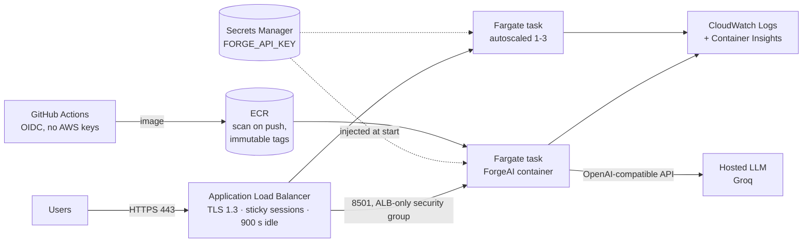

# Production: Docker + AWS

ForgeAI ships as **one container image** that runs the full app (build · results · chat). The same image runs on a
laptop with a local Ollama, in CI, and on AWS ECS Fargate. This document covers why the setup looks the way it does
and how to run it.

## Why containerize it

| Benefit | What it means here |
|---|---|
| **Same on every machine** | "Works on my laptop" disappears: Python 3.11, pinned dependencies, and the same entry point everywhere. The demo machine had App Control blocking `scikit-learn` and `sentence-transformers`; the image sidesteps that whole class of problem. |
| **Localhost parity** | `docker compose --profile local up` runs the app **plus Ollama with the demo's exact 3B models**, the same thing `python -m forge ui` does, in two containers. |
| **Smaller, safer runtime** | Multi-stage build (no compilers in the final image), runs as an unprivileged user (`uid 10001`), and no secrets baked in: the API key arrives as an environment variable at runtime. |
| **Self-healing** | A `HEALTHCHECK` on Streamlit's `/_stcore/health`; orchestrators restart unhealthy containers automatically. |
| **State is explicit** | Runs and the LLM cache live in volumes (`/app/runs`, `/app/.forge_cache`), so containers are disposable and scaling or replacing them loses nothing. |
| **Verified on every push** | GitHub Actions builds the image, starts it, waits for a healthy status, renders the app inside the container, and publishes it to GHCR (`ghcr.io/deeptanshnagar/forage_a1_byoceanai`). |

## Why AWS ECS Fargate (and not App Runner or Lambda)

Streamlit keeps a **long-lived websocket** per browser session, and a build runs for **15–40 minutes**. That rules out
request-per-invocation platforms (Lambda; Vercel functions are capped at 60 s here) and services without websocket
support. Fargate behind an Application Load Balancer handles both:



| Production concern | How the template handles it ([`deploy/aws/cloudformation.yml`](../deploy/aws/cloudformation.yml)) |
|---|---|
| **Zero-downtime deploys** | Rolling update at 100% minimum healthy; new tasks must pass health checks before old ones drain |
| **Bad deploy protection** | ECS **deployment circuit breaker with automatic rollback** |
| **Scaling** | Target tracking on CPU (60%) between `MinTasks` and `MaxTasks` |
| **Websocket sessions** | ALB **sticky sessions** (a Streamlit session stays on one task) and a 900 s idle timeout for long builds |
| **Secrets** | API key in **Secrets Manager**, injected by ECS at start; never in the image, task definition or logs |
| **Least privilege** | The task role has **no AWS permissions**; the execution role can read only this one secret |
| **Network isolation** | Tasks accept traffic **only from the load balancer's security group** |
| **TLS** | Pass an ACM `CertificateArn` → HTTPS on 443 (TLS 1.3 policy) with HTTP→HTTPS redirect |
| **Observability** | CloudWatch Logs (30-day retention) and **Container Insights** metrics (CPU, memory, task count) |
| **Supply chain** | ECR **scan on push**, **immutable tags** (each deploy is a git SHA), GitHub **OIDC** federation instead of stored AWS keys |
| **Cost control** | Public subnets with public IPs, so **no NAT gateway**; scales in to one task when idle |

**Rough cost** (us-east-1 list prices at the time of writing; check the AWS Pricing Calculator): one always-on
1 vCPU / 2 GB Fargate task is about **$36/month**, and an ALB is about **$16/month** plus usage. That's roughly
**$50–60/month** for one task, before LLM API costs (Groq's free tier costs $0).

## Run it

### Locally with Docker (identical to `python -m forge ui`)

```bash
docker compose --profile local up --build                  # app + Ollama, pulls qwen2.5:3b-instruct + llama3.2:3b
docker compose -f docker-compose.yml -f docker-compose.gpu.yml --profile local up --build   # with an NVIDIA GPU
echo "FORGE_API_KEY=<groq key>" > .env && docker compose --profile cloud up --build         # hosted model instead
# → http://localhost:8501
```

Or pull the image that CI publishes: `docker run -p 8501:8501 -e FORGE_API_KEY=<key> ghcr.io/deeptanshnagar/forage_a1_byoceanai:latest`.

### On AWS: one click from GitHub

One-time setup:
1. Create an IAM role that trusts GitHub's OIDC provider for this repository, with permissions for ECR, ECS,
   CloudFormation, IAM role creation, ELB, Secrets Manager, Logs and Application Auto Scaling.
2. Repository **secrets**: `AWS_ROLE_ARN`, `GROQ_API_KEY`.
   Repository **variables**: `AWS_VPC_ID`, `AWS_PUBLIC_SUBNET_IDS` (two subnets in different AZs, comma-separated),
   and optionally `AWS_CERTIFICATE_ARN`.
3. Actions → **Deploy to AWS (ECS Fargate)** → *Run workflow*. It builds, scans and pushes the image to ECR, deploys
   the stack, waits until the service is stable, and prints the URL.

Or manually with the AWS CLI:

```bash
aws ecr create-repository --repository-name forgeai --image-scanning-configuration scanOnPush=true
aws ecr get-login-password | docker login --username AWS --password-stdin <account>.dkr.ecr.<region>.amazonaws.com
docker build -t <account>.dkr.ecr.<region>.amazonaws.com/forgeai:v1 . && docker push <account>.dkr.ecr.<region>.amazonaws.com/forgeai:v1
aws cloudformation deploy --stack-name forgeai --template-file deploy/aws/cloudformation.yml --capabilities CAPABILITY_IAM \
  --parameter-overrides ImageUri=<account>.dkr.ecr.<region>.amazonaws.com/forgeai:v1 VpcId=vpc-… \
  PublicSubnetIds=subnet-a,subnet-b GroqApiKey=<key>
aws cloudformation describe-stacks --stack-name forgeai --query "Stacks[0].Outputs"
```

Tear down with `aws cloudformation delete-stack --stack-name forgeai`, which removes everything except the ECR repository.

## What runs where

| Surface | Host | Purpose |
|---|---|---|
| Full app (build · results · chat) | Docker → **AWS ECS Fargate** (this guide), Streamlit Community Cloud | The product |
| Results site + chat API | **Vercel** (`public/`, `api/chat.py`) | Fast, cacheable evidence pages for reviewers |
| Factory on real local models | Laptop GPU via Ollama, or `docker compose --profile local` | Where the committed demo scores were measured |
